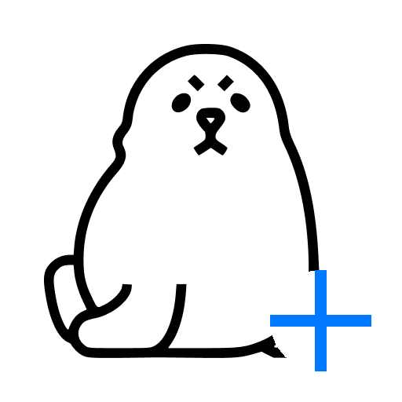

# Seal-Nex

### Video/Audio Downloader for Android 🚀

**Seal-Nex** 是 [JunkFood02/Seal](https://github.com/JunkFood02/Seal) 的派生版本（fork），在原版基础上新增了 **并发多链接下载** 与 **内置 Cookie 浏览器** 两大功能，让下载更快、高清视频更容易获取。

---

---

## ✨ 新增功能（Seal-Nex 独有）

| 功能 | 说明 |
|------|------|
| 🔗 **并发多链接下载** | 在 URL 输入框填入多个链接，用**逗号`、`**或**换行**分隔，最高可同时下载 **3 个任务**，无需一个个等 |
| 🍪 **内置 Cookie 浏览器** | 设置 → 网络 → **Cookie Browser**，内置 WebView 登录 YouTube / B站 等平台，导出 Cookies 供 yt-dlp 使用，解锁高清/会员视频 |
| 📱 **原生 Android 体验** | Material Design 3，动态配色，深色模式，单 Activity 纯 Compose 架构 |

## 📖 原有功能（继承自 Seal）

- 从 900+ 个 yt-dlp 支持的平台下载视频/音频（YouTube、B站、Twitter、Instagram 等）
- 一键下载整个播放列表
- 内嵌 aria2c 外部下载器，支持分段并发下载
- 字幕嵌入、元数据/缩略图嵌入（mutagen）
- 自定义 yt-dlp 命令模板，保存复用
- 应用内下载管理、任务队列、通知栏进度
- 多语言支持（含简体中文、繁体中文）

## 📱 截图

## ⬇️ 下载

前往 [Releases 页面](https://github.com/CheapJBH/seal-nex/releases) 下载最新 APK，或查看 [GitHub Actions 构建产物](https://github.com/CheapJBH/seal-nex/actions)。

推荐安装 **arm64-v8a** 版本（大多数现代手机）。

## 🍪 如何使用 Cookie Browser 获取高清视频

1. 打开 App → 设置 → 网络 → 点击 **Cookie Browser**
2. 在内置浏览器中打开视频平台（如 YouTube、B站），使用你的账号登录
3. 登录成功后，点击底部的 **"导出 Cookies"** 按钮
4. 返回设置 → 网络，打开 **Use Cookies** 开关
5. 现在下载该平台视频时会携带 Cookies，可获取更高画质

## 🔗 如何使用并发多链接下载

1. 在新建下载任务的 URL 输入框中，输入多个视频链接
2. 链接之间用**英文逗号`、`**、中文逗号**，**或**换行**分隔
3. 点击继续，最高 **3 个任务会并发下载**，互不阻塞

## 💬 联系

加入 [Telegram 频道](https://t.me/seal_app) 或 [Matrix Space](https://matrix.to/#/#seal-space:matrix.org) 交流、获取更新。

## 💖 赞助

Seal 将永远免费开源。如果你喜欢，欢迎 [赞助原作者](https://github.com/sponsors/JunkFood02)！

## 🤝 贡献

欢迎贡献代码、翻译、反馈 Bug。提交前请先阅读 [CONTRIBUTING.md](CONTRIBUTING.md)。

可在 [Hosted Weblate](https://hosted.weblate.org/projects/seal/) 参与翻译。

## ⭐️ Star History

## 🧱 致谢

Seal-Nex 基于 [JunkFood02/Seal](https://github.com/JunkFood02/Seal)，核心依赖：

- [yt-dlp](https://github.com/yt-dlp/yt-dlp) — 视频下载引擎
- [youtubedl-android](https://github.com/yausername/youtubedl-android) — Android yt-dlp 绑定
- [aria2](https://github.com/aria2/aria2) — 外部下载器
- [mutagen](https://github.com/quodlibet/mutagen) — 音频元数据
- Material Design 3 / Jetpack Compose — UI 框架

UI 设计与代码参考自 [Read You](https://github.com/Ashinch/ReadYou) 和 [Music You](https://github.com/Kyant0/MusicYou)。

## 📃 许可证

本项目基于 **GPLv3** 许可证开源。

> [!WARNING]
> 除源代码遵循 GPLv3 许可证外，禁止任何第三方将 "Seal" 名称用于下载器 App，其衍生品（包括 fork 和非官方构建）亦同。Seal-Nex 作为派生版本，仅在本仓库分发，不代表原作者 JunkFood02 认可。

<table><td>
<a href="#start-of-content">👆 回到顶部</a>
</td></table>

